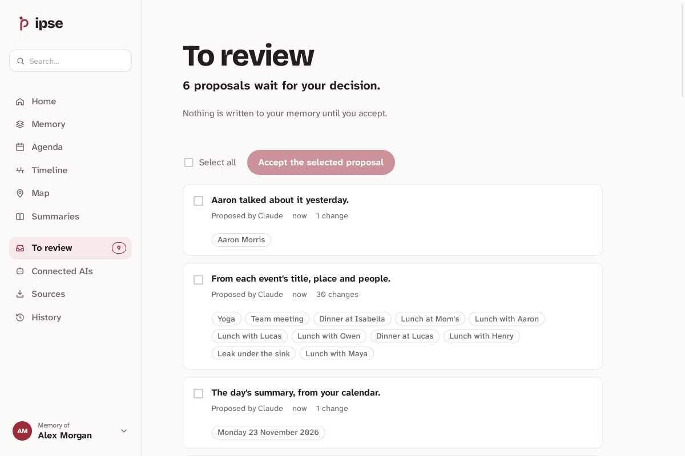
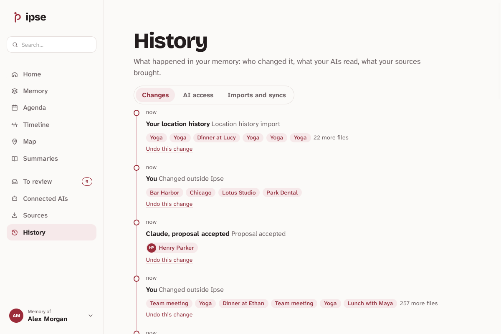

# Ipse

**The memory of your whole life, as files you own. Your AI reads what you allow and suggests changes. Nothing is written until you say yes.**

Your AI forgets who your friends are, what you did last summer and what is on next week, so you tell it again and again. The memory built into AI apps lives on their servers, holds what you happened to type, and changes without asking you.

Ipse is a desktop app for Windows, macOS and Linux. It builds that memory from your contacts, calendars and location history, in a folder of Markdown files on your computer. Any AI app that speaks [MCP](https://modelcontextprotocol.io) (Claude Desktop, Claude Code, LM Studio…) reads it with the rights you give it. When the AI wants to change something, it sends a proposal, and you review it like a pull request:


*Filmed in the desktop app on the invented demo memory: a proposal from Claude, accepted, then undone.*

## Start

[Download the app](https://github.com/Loren844/ipse/releases/latest) for your system and open it ([Install Ipse](docs/guide/install.md) shows each step). Its first screen offers to create your memory or to try an invented one.

Or with the `ipse` command, on macOS or Linux:

```sh
curl --proto '=https' --tlsv1.2 -LsSf https://github.com/Loren844/ipse/releases/latest/download/ipse-installer.sh | sh
ipse init ~/Ipse-demo --demo
ipse client add Claude --install claude-desktop --vault ~/Ipse-demo
```

Restart Claude Desktop and ask it *"Who did I see most this year?"*. [Getting started](docs/guide/getting-started.md) goes from there to your own contacts and calendar, and covers Windows.

## What it does

| | |
| --- | --- |
|  |  |
|  |  |

- **Your whole life, not chat snippets.** People, places, organizations, projects, books and series, and every event, linked together. The agenda shows them by list, week, month and kind. A timeline covers your years, a map shows the places you go, and a graph holds the whole memory.
- **Filled from what you already have.** Contacts (vCard), calendars (`.ics` files, subscription links, CalDAV and CardDAV accounts such as iCloud or Fastmail), and Google Maps location history. Calendars keep syncing in the background.
- **Your AI does the tidying, you decide.** It reads your notes and proposes facts. It finds the same person saved twice, asks who "Mike" is, and writes the summary of your days, months and years. Each proposal shows what would change; you accept, refuse with a comment, or undo later.
- **Rights per AI and per category,** enforced by Ipse, not by a line in a prompt. Health, location, home and private notes stay closed until you open them to one AI.
- **Plain files.** Markdown with a YAML header, readable in Obsidian or any editor. Change a file by hand and Ipse picks it up.

## How it's different

Other projects give AI a memory too. In short, from their own pages in November 2026:

| | Ipse | [Basic Memory](https://github.com/basicmachines-co/basic-memory) | [OpenMemory](https://mem0.ai/blog/introducing-openmemory-mcp) (Mem0) | [Timelinize](https://github.com/timelinize/timelinize) |
| --- | --- | --- | --- | --- |
| What it remembers | Your life: people, places, events, works, summaries | Notes and knowledge you and your AI write | Memories your AI apps add as you chat | Your data from everywhere, on a timeline |
| Stored as | Markdown files, plus a local index | Markdown files, plus a local SQLite index | A vector database, in Docker | Files by date, indexed in SQLite |
| Fills itself from | Contacts, calendars (files, links, CalDAV/CardDAV), location history | Claude and ChatGPT conversations | What your AI apps add | Google Takeout, photos, messages, location, social media |
| How AI changes it | Proposals you accept, refuse or undo | Writes and edits directly | Adds directly | It doesn't: no AI connection |
| Who sees what | Per AI and per category | No rights per AI | Per AI app, from its dashboard | Not made for AI apps |
| To run it | A desktop app, or one command | A Python package; Obsidian to browse | Docker and an OpenAI key | An app to download |

Basic Memory is the closest: Markdown files and MCP, built for knowledge you write with your AI. Timelinize is the best for archiving everything you ever posted or photographed. Ipse is for the memory of a life that your AI uses every day, where the person keeps the last word on what it holds.

## Fast on a real memory

Measured with `cargo bench` on a 4-core Intel Xeon at 2.1 GHz (a cloud virtual machine), on 24 November 2026:

| What | Median |
| --- | --- |
| Read a file of 5 000 contacts (the contacts connector, in its own process) | 48 ms |
| Read a calendar of 10 000 events (the calendar connector) | 134 ms |
| Index a memory of 5 000 people for search | 58 ms |
| Tell whether that memory changed, as the MCP server does on every request | 4.3 ms |
| Search it | 8 µs |

The graph of a whole memory of 22 000 files is laid out in under 20 ms and drawn in under half a second. Each pull request compiles the benchmarks (`crates/*/benches`), and the interface's tests check its frame times.

## Principles

1. **Simple to pick up.** Install in one step, useful without any setup, no technical word in the interface.
2. **Local first.** Nothing leaves your computer without an explicit action from you ([threat model](docs/guide/threat-model.md)).
3. **Open formats.** Markdown and YAML, never a proprietary format.
4. **The human keeps control.** Every AI change is a proposal: visible, reversible, recorded.
5. **Rights enforced by the software**, never by a line in a prompt.
6. **Model-independent.** Any AI app that speaks MCP, with a local model or an online one.

## Roadmap

✅ released · ☑️ done, in the next release · 🔜 planned

- ✅ **Core** ([0.1.0](https://github.com/Loren844/ipse/releases/tag/v0.1.0)): memory format, journal, index, command line, MCP server with rights per category; contacts and calendar; the review inbox with diff and undo, history, connected AIs; tasks for your AI (facts from notes, duplicates, nicknames, summaries); the whole memory in the interface, editing by hand, kinds of events; binaries for every system and a demo memory.
- ✅ **The desktop app** ([0.2.0](https://github.com/Loren844/ipse/releases/tag/v0.2.0)): installers for Windows, macOS and Linux; the agenda by week and month, the timeline, the map; location history; an AI app connected in one command.
- ☑️ **Living in the background**: calendars and contacts accounts (CalDAV, CardDAV), sync while the app runs, notifications, updates checked and signed; views by kind of event; the whole memory as a graph; standing consent for summaries.
- 🔜 **Launch**, once the app is checked on every system ([#157](https://github.com/Loren844/ipse/issues/157)).
- 🔜 **Widening**: more connectors, self-hosted services first (Jellyfin, Immich, Home Assistant…), and a kit for anyone to write one; semantic search with a local model, as an option.
- 🔜 **Mobile**: sync and quick capture.

[CHANGELOG.md](CHANGELOG.md) lists every change; [docs/decisions](docs/decisions) explains why.

## Contributing

The project is not open to outside code contributions yet; bug reports are welcome. See [CONTRIBUTING.md](CONTRIBUTING.md) for the repository layout and building from source, and [SECURITY.md](SECURITY.md) to report a flaw.

## License

[Apache License 2.0](LICENSE).
