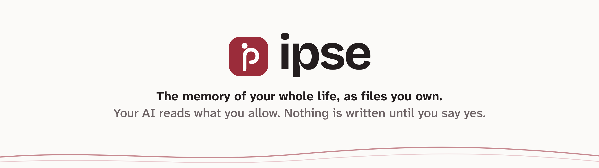
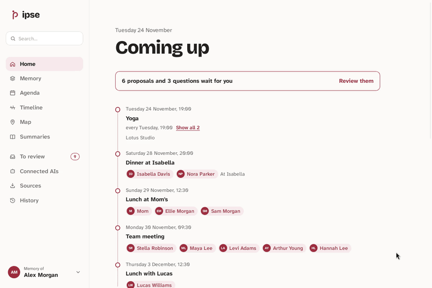
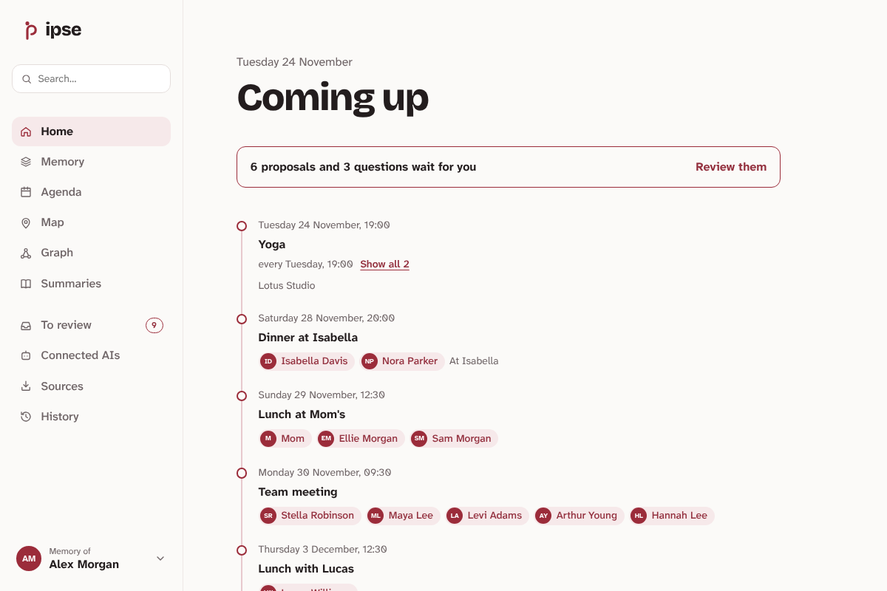
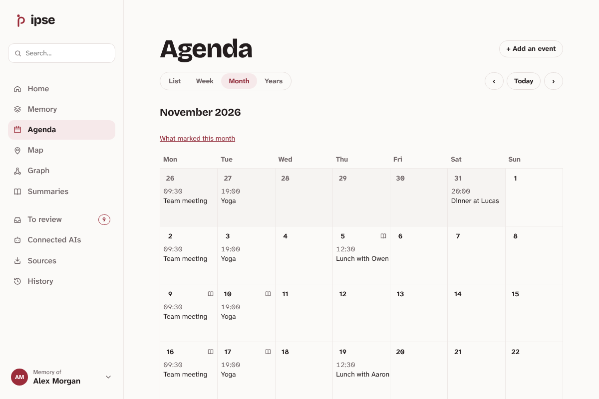
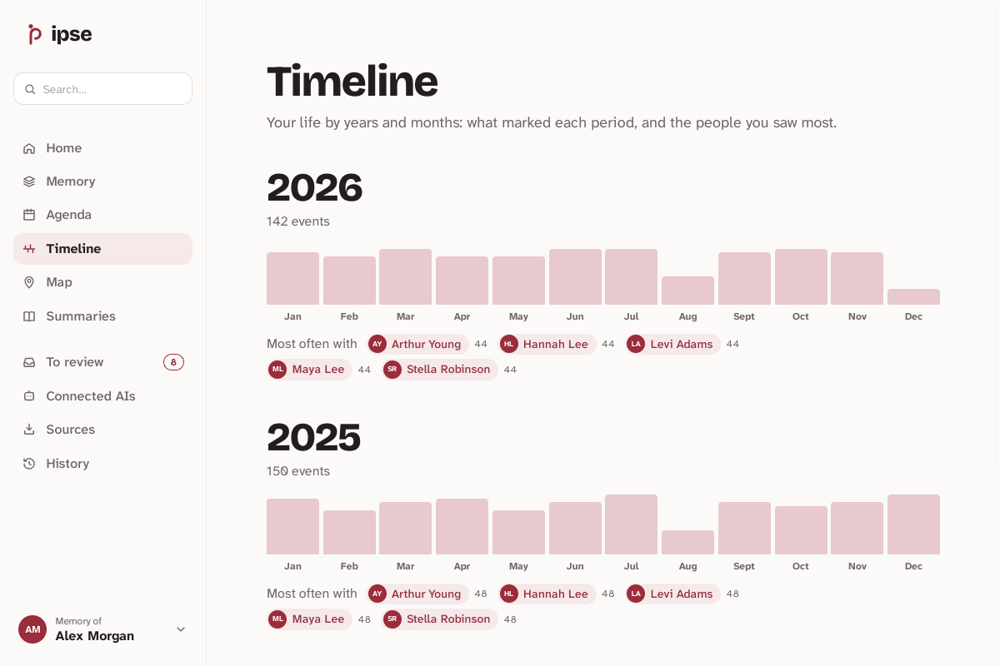
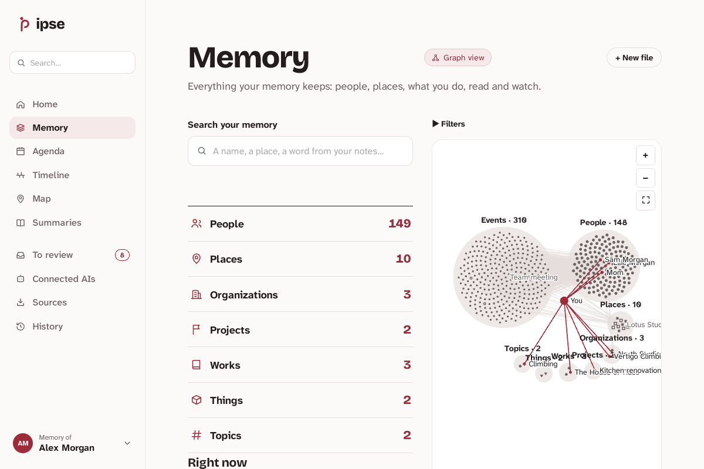
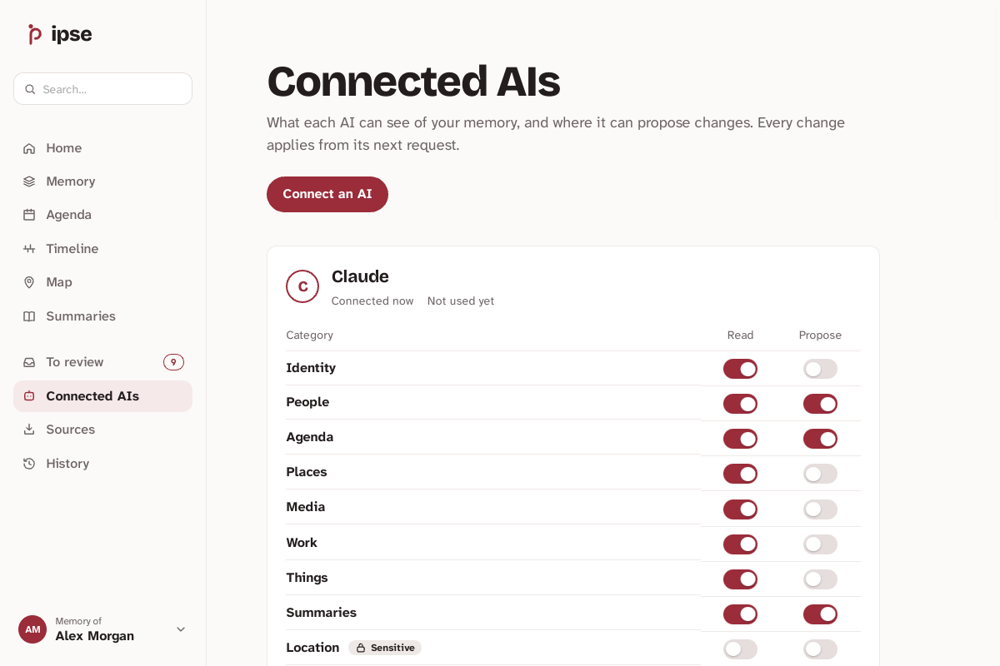

<p align="center">
  <picture>
    <source media="(prefers-color-scheme: dark)" srcset="docs/images/banner-dark.png">
    
  </picture>
</p>

<p align="center">
  <a href="https://github.com/Loren844/ipse/releases/latest"></a>
  <a href="https://github.com/Loren844/ipse/actions/workflows/ci.yml"></a>
  <a href="LICENSE"></a>
  
  <a href="https://modelcontextprotocol.io"></a>
</p>

<p align="center">
  <a href="https://github.com/Loren844/ipse/releases/latest"></a>
  &nbsp;
  <a href="https://github.com/Loren844/ipse/releases/latest"></a>
  &nbsp;
  <a href="https://github.com/Loren844/ipse/releases/latest"></a>
</p>

<p align="center">
  <a href="docs/guide/install.md">Install</a> ·
  <a href="docs/guide/getting-started.md">Getting started</a> ·
  <a href="docs/guide/connecting.md">Connect your AI</a> ·
  <a href="docs/guide/obsidian.md">Obsidian</a> ·
  <a href="docs/guide/self-hosting.md">Home server</a> ·
  <a href="docs/guide/threat-model.md">Privacy</a> ·
  <a href="CHANGELOG.md">Changelog</a> ·
  <a href="https://github.com/Loren844/ipse/issues/new">Report a bug</a>
</p>

<br>

Your AI forgets who your friends are, what you did last summer and what is on next week, so you tell it again and again. **Ipse** keeps that memory for it: your people, places, events and days, built from your contacts, calendars and location history, in a folder of Markdown files on your computer. Any AI app that speaks MCP (Claude Desktop, Claude Code, LM Studio…) reads it with the rights you give it. When it wants to change something, it sends a proposal, and you review it like a pull request.

<p align="center">
  
  <br>
  <sub>A proposal from Claude, accepted, then undone. Filmed in the desktop app on the invented demo memory.</sub>
</p>

## ✨ What it does

<table>
  <tr>
    <td width="50%" valign="top">
      
      <strong>Your days at a glance</strong><br>
      <sub>What is coming up, with whom and where, and what waits for your decision.</sub>
    </td>
    <td width="50%" valign="top">
      
      <strong>Your AI proposes, you decide</strong><br>
      <sub>Facts from your notes, duplicates, nicknames, summaries of your days: each shows what would change. Accept, refuse with a comment, or undo later.</sub>
    </td>
  </tr>
  <tr>
    <td width="50%" valign="top">
      
      <strong>Your agenda, kept in sync</strong><br>
      <sub>Calendar files and links, iCloud, Fastmail or any CalDAV and CardDAV account, synced in the background. By list, week, month and kind.</sub>
    </td>
    <td width="50%" valign="top">
      
      <strong>Your life by years and months</strong><br>
      <sub>What marked each period and the people you saw most; a map of the places you go, from your location history.</sub>
    </td>
  </tr>
  <tr>
    <td width="50%" valign="top">
      
      <strong>Your whole memory, linked</strong><br>
      <sub>Start from you or any file: the people you see most, the places, projects and relations around it, each link said in words.</sub>
    </td>
    <td width="50%" valign="top">
      
      <strong>Rights per AI and per category</strong><br>
      <sub>Enforced by Ipse, not by a line in a prompt. Health, location, home and private notes stay closed until you open them.</sub>
    </td>
  </tr>
</table>

## 🚀 Start

[Download the app](https://github.com/Loren844/ipse/releases/latest) and open it: its first screen creates your memory, or an invented one to try. [Install Ipse](docs/guide/install.md) shows each step.

Or with the `ipse` command, on macOS or Linux:

```sh
curl --proto '=https' --tlsv1.2 -LsSf https://github.com/Loren844/ipse/releases/latest/download/ipse-installer.sh | sh
ipse init ~/Ipse-demo --demo
ipse client add Claude --install claude-desktop --vault ~/Ipse-demo
```

Restart Claude Desktop and ask it *"Who did I see most this year?"*. [Getting started](docs/guide/getting-started.md) goes on to your own contacts and calendar, and covers Windows.

## 💡 Why Ipse

- **Your whole life, not chat snippets.** A memory of people, places and events, filled from what you already have, rather than scraps of what you once typed to an AI.
- **Files you own.** Markdown with a YAML header in a folder of yours, readable in [Obsidian](docs/guide/obsidian.md) or any editor. Change a file by hand and Ipse picks it up. No account, no server, no cloud.
- **Nothing is written behind your back.** Data your sources bring is imported as it is; anything an AI infers is a proposal you accept, refuse or undo, and the history says who changed what.
- **You choose what each AI sees,** category by category, and Ipse enforces it in the code that answers.
- **Any model.** Through the open [Model Context Protocol](https://modelcontextprotocol.io), with a local model or an online one.

## ⚡ Fast on a real memory

Measured with `cargo bench` on a 4-core Intel Xeon at 2.1 GHz (a cloud virtual machine), on 24 November 2026:

| What | Median |
| --- | --- |
| Read a file of 5 000 contacts (the contacts connector, in its own process) | 48 ms |
| Read a calendar of 10 000 events (the calendar connector) | 134 ms |
| Index a memory of 5 000 people for search | 58 ms |
| Tell whether that memory changed, as the MCP server does on every request | 4.3 ms |
| Search it | 8 µs |

In a memory of 22 000 files, the graph around a file opens in under half a second.

## 🧭 Principles

1. **Simple to pick up.** Install in one step, useful without any setup, no technical word in the interface.
2. **Local first.** Nothing leaves your computer without an explicit action from you ([threat model](docs/guide/threat-model.md)).
3. **Open formats.** Markdown and YAML, never a proprietary format.
4. **The human keeps control.** Every AI change is a proposal: visible, reversible, recorded.
5. **Rights enforced by the software**, never by a line in a prompt.
6. **Model-independent.** Any AI app that speaks MCP, local or online.

## 🗺️ Roadmap

✅ released · 🔜 planned

- ✅ **Core** ([0.1.0](https://github.com/Loren844/ipse/releases/tag/v0.1.0)): memory format, journal, index, command line, MCP server with rights per category; contacts and calendar; the review inbox with diff and undo, history, connected AIs; tasks for your AI (facts from notes, duplicates, nicknames, summaries); the whole memory in the interface, editing by hand, kinds of events; binaries for every system and a demo memory.
- ✅ **The desktop app** ([0.2.0](https://github.com/Loren844/ipse/releases/tag/v0.2.0)): installers for Windows, macOS and Linux; the agenda by week and month, the timeline, the map; location history; an AI app connected in one command.
- ✅ **Living in the background** ([0.3.0](https://github.com/Loren844/ipse/releases/tag/v0.3.0)): calendars and contacts accounts (CalDAV, CardDAV), sync while the app runs, notifications, signed updates; views by kind of event; the whole memory as a graph; standing consent for summaries.
- 🔜 **Launch**, once the app is checked on every system ([#157](https://github.com/Loren844/ipse/issues/157)).
- 🔜 **Widening**: more connectors, self-hosted services first (Jellyfin, Immich, Home Assistant…), and a kit for anyone to write one; semantic search with a local model, as an option.
- 🔜 **Mobile**: sync and quick capture.

[CHANGELOG.md](CHANGELOG.md) lists every change; [docs/decisions](docs/decisions) explains why.

## 🤝 Contributing

The project is not open to outside code contributions yet; bug reports are welcome. See [CONTRIBUTING.md](CONTRIBUTING.md) for the repository layout and building from source, and [SECURITY.md](SECURITY.md) to report a flaw.

## 📜 License

[Apache License 2.0](LICENSE).
