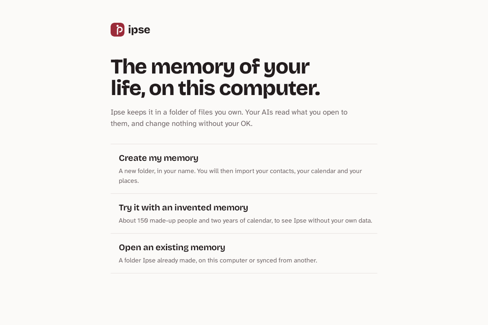
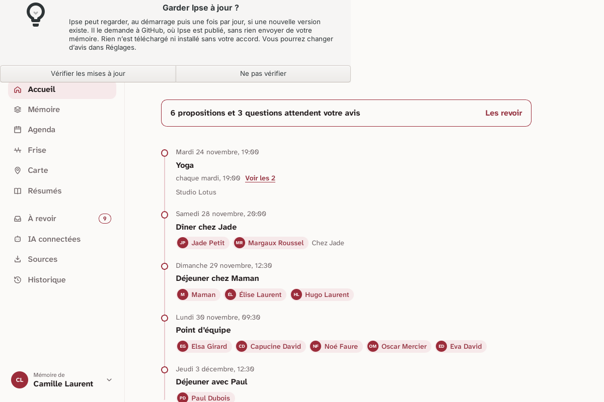
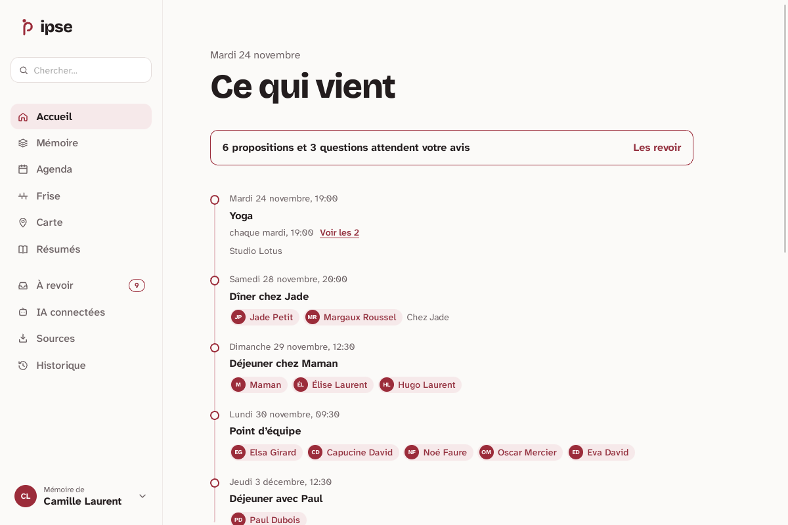
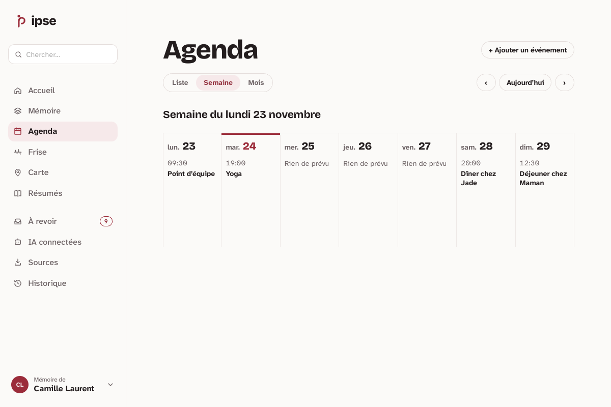
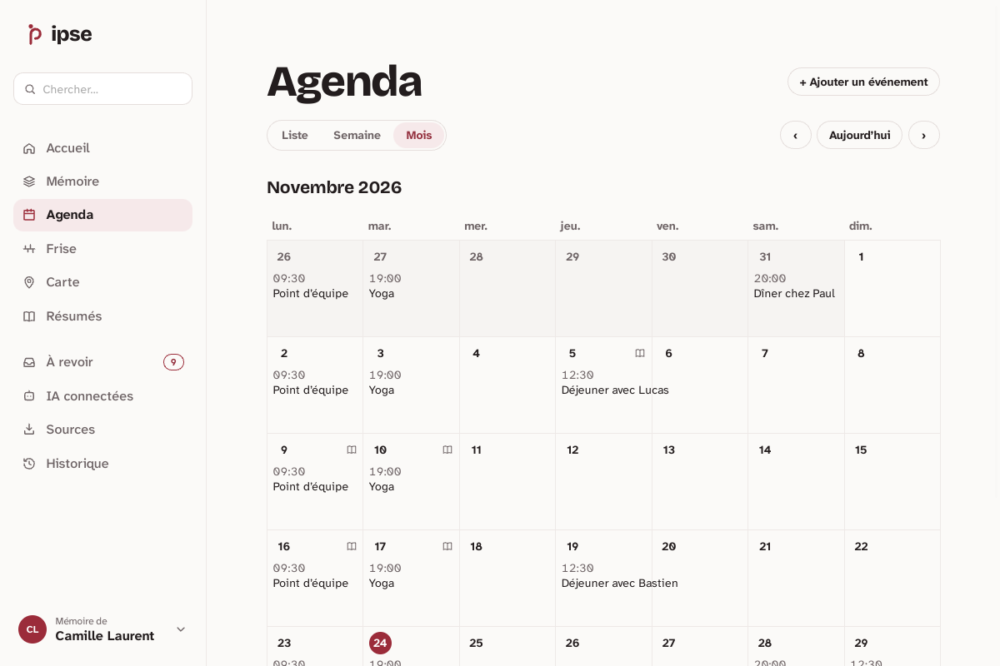
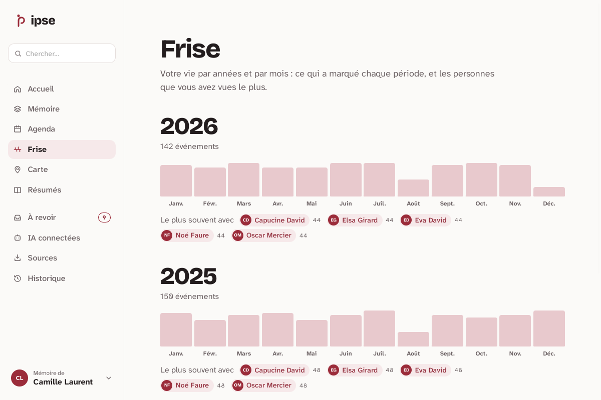
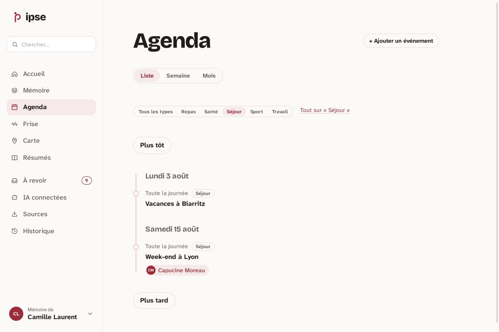
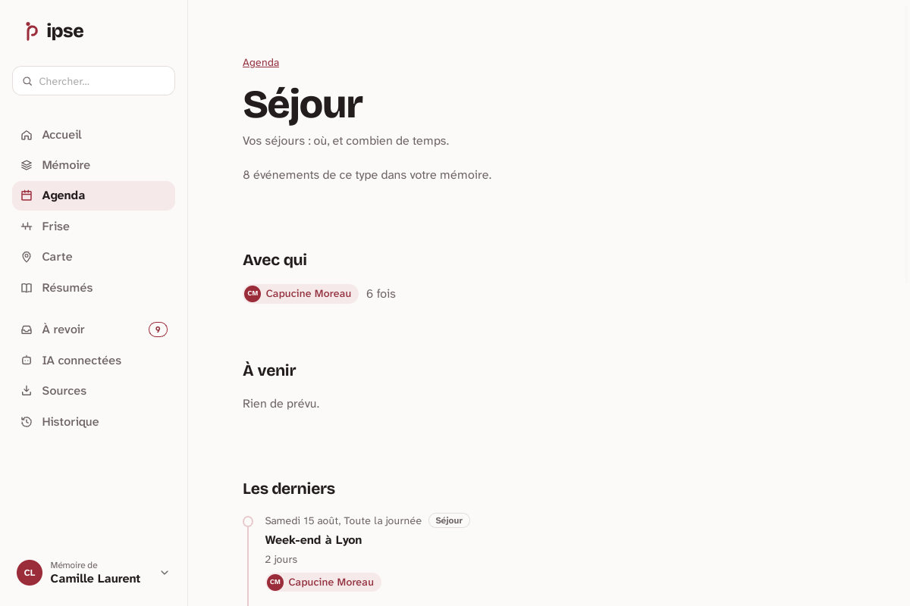
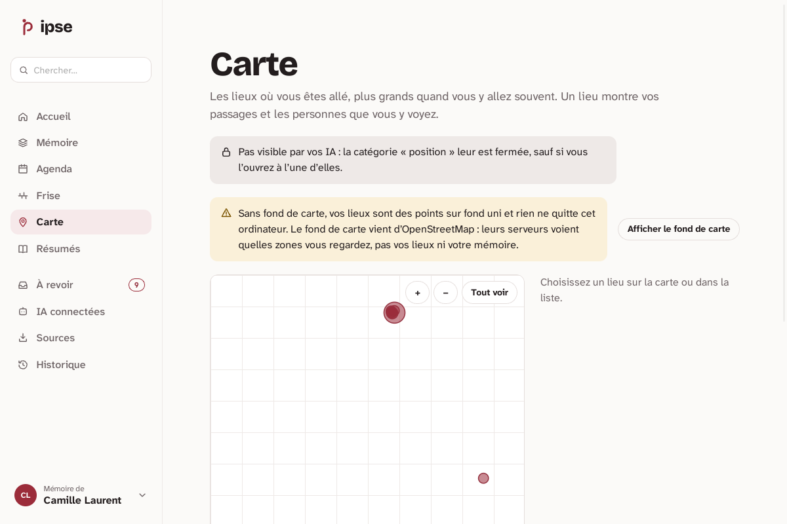
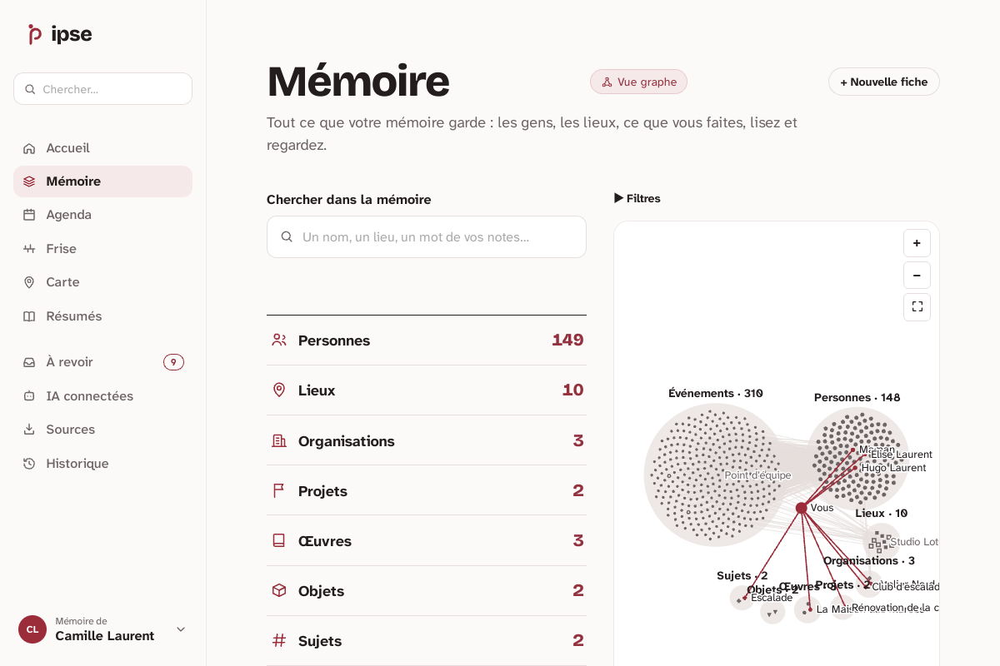

# Milestone 3: the app, end to end

What was checked before the launch (issue #157, decision 0015), how, and what is left to check by hand. The screenshots are of the desktop app on Linux, with the invented memory (`ipse init --demo --language fr`), on 23 and 24 November 2026.

## Checked by CI, on every release

| What | Where | Systems |
| --- | --- | --- |
| The installer of the release installs the app and the `ipse` command; the app opens the invented memory and starts `ipse ui --app` | `acceptance.yml`, `.github/scripts/acceptance.py` | Windows, macOS, Linux |
| Quitting the app stops `ipse ui --app` (on Windows the test can only end the app's process abruptly, which skips its exit: the check is by hand) | same | macOS, Linux |
| Claude Desktop is connected with the installed command (`ipse client add Claude --install claude-desktop`), and the server its configuration starts answers over MCP with Ipse's tools | same | Windows, macOS, Linux |
| An old version finds the new one, checks its signature and replaces itself | `app-update.yml` | Linux |
| A calendar that is due syncs on its own in the background; a failing one and a new proposal are told to the app | `crates/ipse/tests/background.rs` | Windows, macOS, Linux |
| Every view of the milestone (agenda's week and month, timeline, kinds, map, graph) | `ui/tests/*.spec.ts` | Linux, in Chromium |

`acceptance.yml` runs once the app's installers are attached to a release, and by hand for any release (**Actions → Acceptance → Run workflow**). Each run keeps a screenshot of the app per system.

## Checked by hand on Linux

- The `.AppImage` and the `.deb` of 0.2.0, from the release: the first screen, then **Try it with an invented memory**, open the memory.
- The app built from `main`: the question about updates at the first start, then every view below.

| | |
| --- | --- |
|  |  |
|  |  |
|  |  |
|  |  |
|  |  |

## To check by hand on macOS and Windows

These need a person: a real Claude Desktop, a calendar on the internet, and a release that can update itself (0.3.0 and later; 0.2.0 has no updater).

- [ ] Install from the release's `.dmg` / `.msi`; the first time, **Open Anyway** (macOS) or **Run anyway** (Windows), as [Install Ipse](../guide/install.md) says.
- [ ] First start: **Try it with an invented memory**; the question about updates.
- [ ] **IA connectées → Connect Claude Desktop**; quit Claude Desktop, open it again: Ipse is among its connectors, and *"What's on my agenda this week?"* gets the invented agenda.
- [ ] **Sources**: follow a calendar by its secret link; close the window: Ipse stays in the menu bar or the tray; an event added to that calendar appears at the next sync, without opening the window.
- [ ] Windows: **Quit** from the tray's menu; `ipse.exe` is no longer in the Task Manager.
- [ ] Each view: agenda (list, week, month, a kind), timeline, map (with and without its base map), the graph.
- [ ] Update: with 0.3.0 installed, once 0.3.1 is released, the window offers it; **Install and restart** opens 0.3.1.

## Found

- The graph, beside the memory's list, is taller than what a window 800 pixels high shows below the heading: at first, the lower half of the drawing, with you at its center, is below the fold until the page scrolls ([#198](https://github.com/Loren844/ipse/issues/198)).
